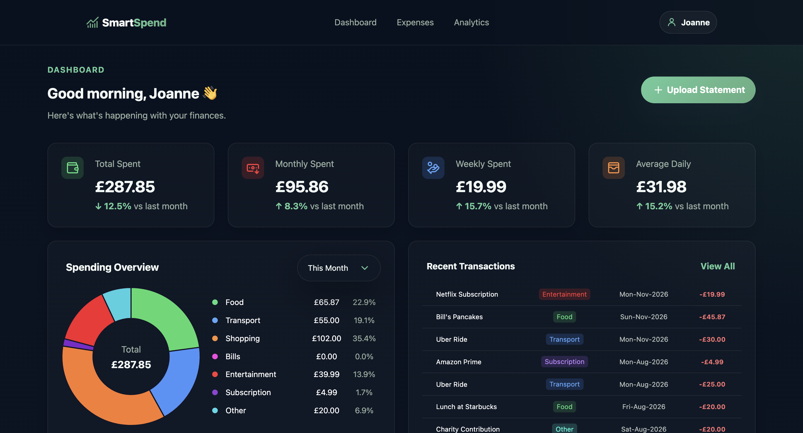
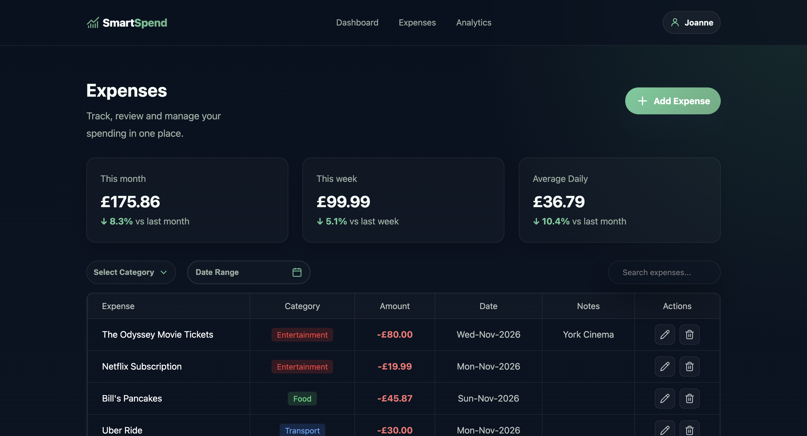
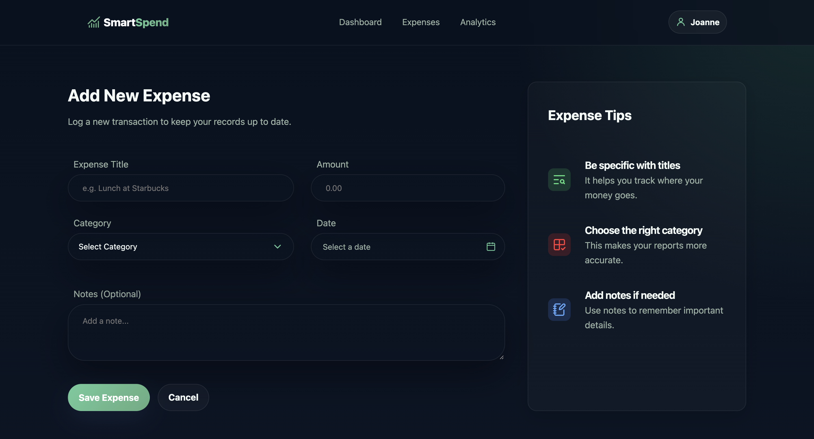

# 💸 SmartSpend

SmartSpend is a personal finance analytics platform built with **Flask**, **SQLAlchemy**, and vanilla web technologies. It helps users track expenses, monitor spending, and gain insights into their financial habits.


The project starts as a clean Flask application, then grows feature by feature into a cutting-edge web application for expense tracking, analytics, and future machine learning experiments.

---

## ✨ Current Features

- Modern responsive dashboard
- Expense management page
- Add Expense form
- Dynamic expense tracking with Flask
- Categorised expenses
- Clean dark UI with green accent theme
- User authentication and account management
- SQLite database integration
- Add, view, edit and delete expenses
- Dynamic expense table using Flask and Jinja2
- Spending charts and visualisations
- Analytics dashboard

---

## 🚧 Features in Progress

- Search and filtering
- AI insights

---

## 🛠️ Tech Stack

- **Backend:** Python, Flask
- **Frontend:** HTML, CSS, JavaScript
- **Database:** SQLite
- **ORM:** SQLAlchemy
- **Templating:** Jinja2
- **Development:** Visual Studio Code, Git, GitHub
---

## 📂 Project Structure

```
SmartSpend/
│
├── app.py
├── models.py
├── database.py
├── schema.sql
├── templates/
│   ├── add_expense.html/
│   ├── analytics.html/
│   ├── base.html/
│   ├── edit_expense.html/
│   ├── dashboard.html/
│   ├── expenses.html/
│   ├── home.html/
│   ├── login.html/
│   └── signup.html/
├── static/
│   ├── css/
│   ├── js/
│   └── images/
└── README.md
```

---

## What I Learned

Through building SmartSpend, I developed experience with:

- Building a web application using Flask
- Connecting a Python backend to a SQLite database
- Designing and querying database models with SQLAlchemy
- Using Jinja2 to dynamically display database data
- Implementing user authentication
- Using JavaScript to create interactive features
- Structuring a project using separate templates, models and routes
- Using Git and GitHub for version control

---

## 📸 Screenshots

## Home


## Add Expense



## Expenses



## Add Expense




---

## 🎯 Roadmap

- [x] User authentication
- [x] Add expenses
- [x] Display expenses
- [x] Delete expenses
- [x] Expense categories
- [ ] Search expenses
- [ ] Category and date filtering
- [ ] Dynamic spending analytics
- [x] Edit expenses
- [x] Data visualisations
- [ ] Budget tracking
- [ ] Deploy application

---

## Run Locally

```bash
python app.py
```

Then open:

```text
http://127.0.0.1:5000
```
